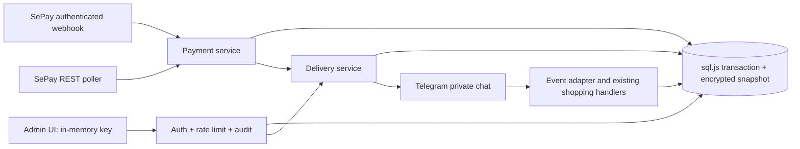

# XiaoP ShopBot v3 architecture

XiaoP Shop / XP Digital Hub. Node 24, Express 5, Telegram SDK 2 API adapter, sql.js, static administration UI. Single shop and single writer. No infrastructure resources are provisioned by the application.

Payment invariants: `(provider, transaction_id)` unique; each order can have one ledger entry; only pending, unexpired VietQR orders on the expected bank account can be auto-paid. The bank destination is captured at checkout for new orders. Legacy orders use the active account until replaced. Incoming amounts must be positive safe integer VND and at least the total. Only one unambiguous whole order token is accepted. Partial payments are not combined; review/refund them manually. Expired/unmatched payments require bank reconciliation; they are acknowledged without fulfillment. Polling covers up to 100 recent transactions from the previous day onward, so high-volume shops need paginated reconciliation before scaling.

Database mutations use a synchronous transaction with a pre-write snapshot. No await is allowed within transactions. Commit is followed by AES-256-GCM encryption, file fsync and atomic rename. If persistence fails, live memory is restored to the pre-call snapshot. A lock file prevents a second process from opening the same DB. Rename is atomic on a local volume; network filesystems and multiple replicas are unsupported. The entire database is encrypted at rest, including audit, credentials and customer data. It is plaintext in process memory and necessarily sent to the intended buyer through Telegram.

Delivery jobs use `ready → sending → sent`, with `review` for ambiguous failure and `manual` for invite/preorder services. Allocation marks credential IDs sold and attaches them to an order before I/O. Restart recovery processes paid orders and ready jobs, but never automatically resends sending/review jobs. An admin can retry existing allocations; Telegram has no exactly-once send guarantee. A successful message followed by an uncertain acknowledgement can lead to a duplicate message on an explicit retry, but not a fresh credential allocation. Manual completion refuses unresolved credential jobs in a mixed cart.

Catalog categories can represent Digital Products, AI Services, Authorized Accounts and Cloud/VPS. Use credential delivery for licensed codes or provisioned accounts and preorder/manual delivery for Cloud/VPS provisioning. Provisioning never purchases a server automatically. Existing cart, coupons, history, currency display, Vietnamese/English menus, subscription reminders and support links remain. `/support ORD… message` records an owned-order ticket; administrators resolve tickets in the dashboard. Renewal extends an existing future expiry. No automatic recurring charging or automated warranty replacement is claimed.

The browser uses DOM text nodes, external local assets and CSP. Admin credentials remain in memory and are removed on logout; reload requires sign-in. API access is single-operator authentication, not multi-user RBAC. API audit stores method/path intent without body, credentials or query strings; payment/delivery operations additionally record outcomes. Deploy behind TLS and restrict admin access at the ingress when available. The application does not trust arbitrary forwarded IP headers.

Before multi-shop expansion: migrate storage to PostgreSQL, introduce tenant-scoped authorization, jobs with leases, secret management per shop, webhook routing, provider event retention and per-item subscription records. These are future extensions, not implemented tenancy guarantees.
